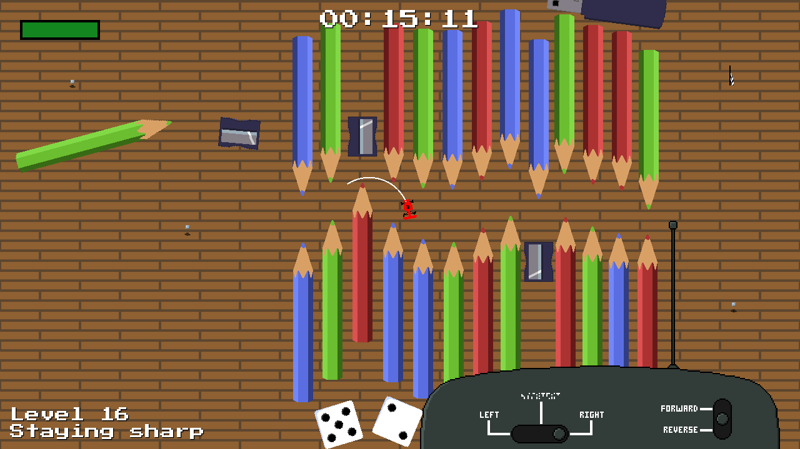
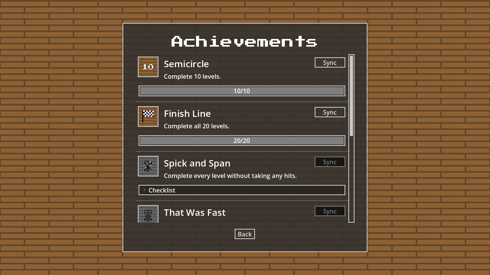
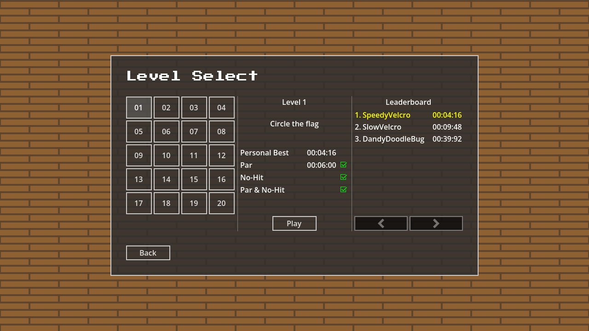

I've finally returned to [CircleRC](/games/circlerc) and released the 1.2
update! With this update the game is FINALLY coming to
[Newgrounds](https://www.newgrounds.com/portal/view/project/8133086) and
[Game Jolt](https://gamejolt.com/games/circlerc/1102290).

Read on to see what's new.

<!--more-->

The headline is a bunch of new content. It's still a pretty short game, but I've
added new levels to bring the level count up to an even 20. These levels come
with a host of new bric-a-brac obstacles to navigate around, and fresh new
(dubiously) funny captions.

As is becoming a mainstay with my games, I've added achievements. I've
backported the achievement system you've seen in Advanced Invasion and Squid
Savings to CircleRC, so you'll have a bunch of new challenges to complete once
you've finished all the levels and want something new to aim for.

And that brings us to the feature that excites me the most. With Newgrounds and
Game Jolt API integrations added to the game, I've decided to add high scores
to one of my games for the first time! CircleRC is a good fit for this being
a time trial game.

If you want to play for a high score, I would probably recommend playing on
Newgrounds. Given that Newgrounds has the better discovery system for new games,
I suspect leaderboards will be a lot more active there.

No high-scores on itch.io unfortunately. Itch doedsn't have an API for that and
I haven't set up my own backend or anything so there's nowhere to send them too.
However, itch-players hopefully shouldn't feel too left out of the competition
as each level now has a par time you can try for!

If you want to see the specifics of exactly what's in the update
then the change notes are at the end of this post. Have fun!

## Change Notes
This update finally gets CircleRC ready for its Newgrounds and Game
Jolt releases by adding achievements and leaderboards for those
platforms, and rounding off the level roster at an even 20 levels.
You'll also find the menus and UI a lot more polished across the board.

### Gameplay
- Added new static obstacles including dice, pencil sharpeners, memory
  sticks, sunglasses and poker chips.
- Added 6 new levels between level 12 and level 13. Levels 13 and 14
  have been pushed to the end so they are now level 19 and 20.
- Levels now have a par time. If you finish under par, this is tracked
  in the level select screen.
- Levels now track whether you complete them without being hit. They
  also track whether you have completed the level both under par AND
  no-hit in the same attempt.
- Added an achievement system, with several new achievements to earn.

### UI
- Overhauled main menu, including some slick new animations.
- Overhaul the About menu. The About menu is now much better organised and goes
  into explicit detail on the licenses of all software components.
- Added an options menu with several new settings include volume settings
  and control bindings.
- Added an achievement menu to display the new achievements.
- Added a sidebar with social links to the main menu. Give me a follow
  to keep up with new developments!
- Level select screen now displays par time and completion of certain
  objectives (par, no-hit, etc.)
- On Newgrounds and Game Jolt, the level select screen and victory
  screens now show a leaderboard with high scores from those platforms.
- When you complete all 20 levels, you will now be greeted with an
  ending screen with a credits scroll, confetti cannons, and a party
  noise-maker.

### Bug Fixes
- Fixed a matchbox in level 19 (was level 13) that had missing collision
  detection.

### Technicals
- Updated engine version to Godot 4.7.2
